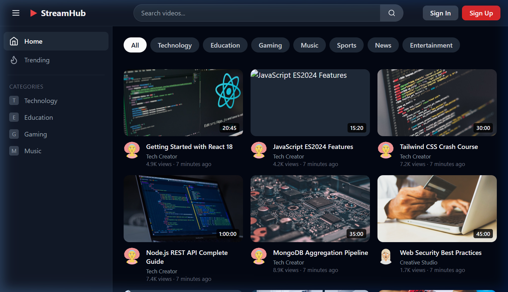
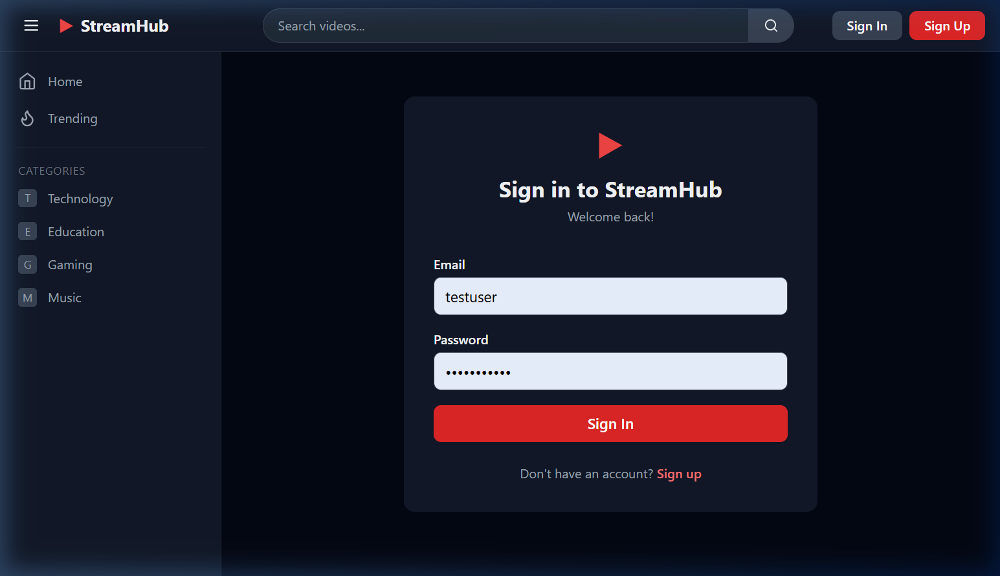
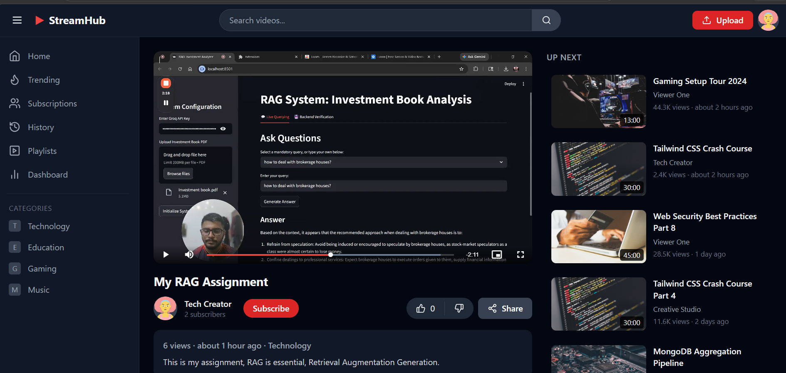
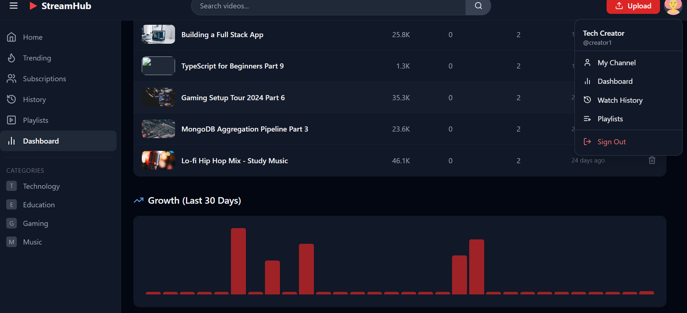

# StreamHub — Premium MERN Video Streaming Platform

StreamHub is a state-of-the-art video streaming ecosystem, engineering a high-fidelity experience from the ground up. Combining the power of the **MERN stack** with absolute **Cloudinary video resilience** and a deep **Llama-3 powered AI Recommendation Engine**, StreamHub offers a truly modern platform for creators and viewers alike.

---

### [Visit the Live Deployment](https://video-streamhub-mern.onrender.com/)

---

## Key Technical Highlights

- **Bespoke UI / UX Framework**
  - Experience fluid dark mode aesthetics with **Glassmorphism** navigation components.
  - Interactive video cards with smooth CSS transitions and micro-animations.
  - Fully responsive grid architecture tailored for mobile, tablet, and ultra-wide displays.

- **Intelligent AI Recommendations**
  - Powered by **Llama-3-8B** (via Groq API) for sub-second contextual logic.
  - Analyzes granular `WatchHistory` and video metadata to predict user preferences.
  - Robust fallback mechanisms ensure stability even under high API load.

- **Resilient Media Pipeline**
  - **Chunked Stream Uploads:** Bypasses memory-limit bottlenecks and proxy timeouts.
  - **Background Processing:** Immediate user feedback with asynchronous database persistence.
  - **Premium Player:** Integrated Video.js for consistent, high-performance playback across browsers.

- **Creator Analytics & Mastery**
  - Integrated **Recharts** dashboard for 30-day growth visualization.
  - Full CRUD control over video catalog with instant UI state synchronization.

---

## UI Showcase

| Homepage Preview | Logged-in Discovery |
| :---: | :---: |
|  |  |

| Video Watch Experience | Creator Mastery Dashboard |
| :---: | :---: |
|  |  |

---

## 🛠 Tech Architecture

### Frontend
- **React 18** (Vite runtime)
- **Axios** (Extended 5-minute timeout for large-file resilience)
- **Recharts** & **Video.js**
- **TailwindCSS** for utility precision

### Backend
- **Node.js** & **Express.js**
- **MongoDB** & **Mongoose ORM**
- **Cloudinary** (Media Engine)
- **Groq SDK** (AI Execution Engine)

---

## Local Installation

### 1. Requirements
Ensure you have **Node.js v18+**, **MongoDB**, **Cloudinary**, and **Groq** API keys.

### 2. Setup Repository
```bash
git clone https://github.com/ChandanKT-git/Video-StreamHub-MERN.git
cd Video-StreamHub-MERN
npm run build
```

### 3. Environment Config
Create `server/.env` and supply:
```env
PORT=5000
MONGODB_URI=your_mongodb_cluster_uri
JWT_SECRET=your_secret_key
CLOUDINARY_CLOUD_NAME=your_name
CLOUDINARY_API_KEY=your_key
CLOUDINARY_API_SECRET=your_secret
GROQ_API_KEY=your_llama_key
```

### 4. Initialize & Ignite
```bash
npm run seed  # Optional: Seed the database with analytics-ready data
npm run dev   # Launch concurrent development servers
```

Visit **[http://localhost:5173](http://localhost:5173)** to explore the project!
